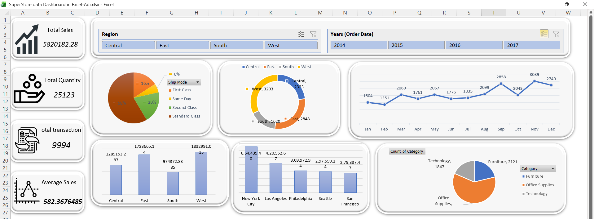
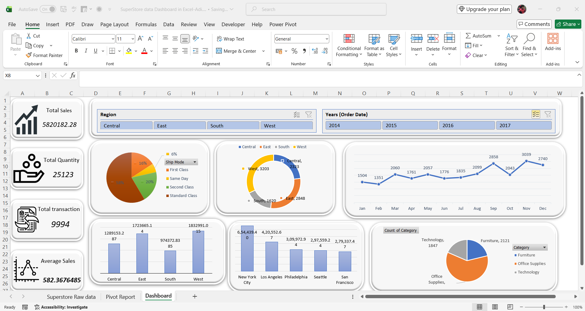

# Superstore Sales Dashboard | Microsoft Excel

An interactive sales dashboard built in Microsoft Excel to explore Superstore sales performance across regions, years, months, shipping modes, cities, and product categories.

## Dashboard Previews

### Preview 1

### Preview 2

## Key Performance Indicators

| KPI | Dashboard Value |
|---|---:|
| Total Sales | 5,820,182.28 |
| Total Quantity | 25,123 |
| Total Transactions | 9,994 |
| Average Sales | 582.37 |

## Dashboard Features

- **KPI cards:** Total Sales, Total Quantity, Total Transactions, and Average Sales.
- **Interactive region slicer:** Filter results for Central, East, South, and West.
- **Year slicer:** Explore data for 2014, 2015, 2016, and 2017.
- **Shipping analysis:** View the distribution of orders by Ship Mode.
- **Regional analysis:** Compare sales across the four regions.
- **Monthly trend:** Review the month-wise sales trend.
- **City analysis:** Compare sales across selected cities.
- **Category analysis:** Explore the distribution of orders across Furniture, Office Supplies, and Technology.

## Tools & Excel Features

- Microsoft Excel
- PivotTables and PivotCharts
- Slicers
- Dashboard layout and KPI cards
- Interactive data filtering

## Workbook Structure

- `Superstore Raw data` — source data worksheet
- `Pivot Report` — PivotTable/report worksheet
- `Dashboard` — interactive dashboard worksheet

## How to Use

1. Download `SuperStore-Sales-Dashboard.xlsx`.
2. Open it in Microsoft Excel (desktop version recommended).
3. Go to the **Dashboard** worksheet.
4. Use the Region and Years slicers to filter the dashboard.
5. Use the chart filter controls where available to explore the visual breakdowns.

> Note: The dashboard previews are included in the `images` folder and displayed above. The Excel workbook is included in this repository package.

## Project Objective

The objective of this project is to turn raw Superstore sales data into an interactive Excel dashboard that makes key sales metrics and business trends easier to explore.

---

**Created by:** Aditya  
**Project:** Excel Data Analytics Portfolio
